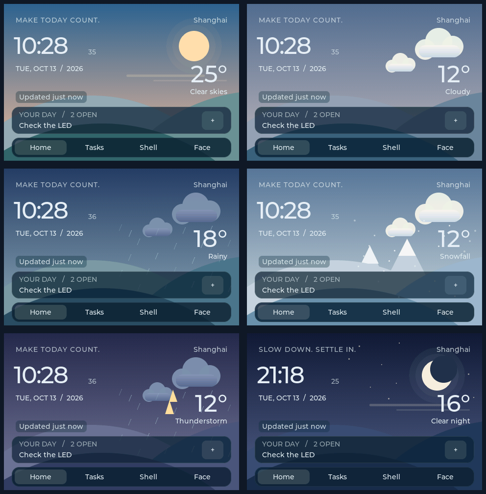

# FRDM-MCXN947 板卡路测：桌面机器人中的资源分配、Zephyr 实现与调试

> 项目：FRDM-MCXN947 桌面智能机器人。主控固件 Robot 0.8.1，Zephyr 4.4.1，LVGL 9.5.0。资源与运行数据取自对应工程的构建报告和板上回归记录，整理日期为 2026 年 10 月 21 日。

FRDM-MCXN947 在这个项目中承担机器人主控、触摸界面、文件日志和设备管理。系统将动态表情、时间天气桌面、待办、可视化 Shell、串口通信和基础诊断整合到同一份 Zephyr 固件中，ESP32-WROOM-32E-N4 则承担无线节点的职责。

这类项目的工程难点集中在资源共用：LCD 持续刷新，UART 同时收发，文件系统写入日志，Shell 随时接受命令。评价板卡是否合适，需要结合内存分区、线程栈、DMA 传输和外设时钟分析，而不能只比较主频。

## 一、硬件资源与统一工程

MCXN947 提供最高 150 MHz 的双 Cortex-M33、2 MB 片内 Flash，以及 eIQ Neutron NPU、PowerQuad 等计算资源。FRDM 板集成 MCU-Link 调试器，并提供外部 QSPI Flash、以太网和 CAN-FD 相关硬件，适合搭建包含显示、存储和通信的控制系统。[NXP 板卡介绍][ref-board]、[MCX N 系列资料][ref-nxp]

| 项目组成 | 工程配置与作用 |
|---|---|
| 主控 | FRDM-MCXN947，CPU0 执行统一 Robot 固件 |
| 显示与输入 | LCD-PAR-S035，480×320、RGB565，FlexIO 8080 显示接口与触摸输入 |
| 无线节点 | ESP32-WROOM-32E-N4，RobotNode 0.1.1，ESP-IDF 6.0.2 |
| 节点通信 | N947 UART2，115200、8N1；数据帧解析、响应、超时和状态统计 |
| 板载存储 | 外部 QSPI Flash 中划分 LittleFS，保存日志和待办数据 |
| 设备模块 | RGB LED、SW2/SW3，LD2410S 串口解析与参数命令接口 |
| 开发工具 | VS Code、MCUXpresso、Zephyr SDK 1.0.1、LVGL Pro Editor |

构建目标为 `frdm_mcxn947/mcxn947/cpu0`，屏幕 shield 为 `lcd_par_s035_8080`。固件采用单一 CPU0 Zephyr 镜像，移除 TF-M／BL2 对本工程的镜像和内存分区要求；CPU1、共享区具有独立资源边界。这种调整释放的是软件占用及分区限制，芯片的物理容量保持不变。

```text
                    同一份 CPU0 Zephyr 固件
  Shell 命令 ─┐
              ├─ 业务接口与共享数据模型 ── LVGL 桌面/待办/表情
  触摸操作 ──┘             │
                  消息队列与工作线程
                 ┌─────────┼──────────┐
             LittleFS   UART2节点通信   GPIO/雷达接口
                 │          │
             QSPI Flash   ESP32无线节点

  Logging ── 文件后端 ── LittleFS
  系统诊断 ── 状态、错误码、栈水位、内存统计
```

UI 与底层共用业务模型。屏幕修改待办、串口修改待办和通信侧提交数据，最终都进入相同的数据管理接口。PC 预览复用界面源码，便于检查布局；板上构建负责屏幕、触摸、线程和存储适配。

## 二、内存分析：先区分容量、分区与运行占用

### 1. Flash 和 RAM 的分配

MCXN947 的 SRAM 标称容量为 512 KB，启用全 ECC 时对应可用容量口径为 416 KB。工程进行地址分配时还要区分普通 SRAM 与 SRAMX，避免把不同区域直接视为连续的大内存池。[NXP MCX N 资料][ref-nxp]

| 区域 | 分配大小 | 工程用途 |
|---|---:|---|
| CPU0 Flash | 1,536 KiB | Zephyr、驱动、业务代码、LVGL 与常量资源 |
| CPU1 Flash | 512 KiB | 独立核心镜像空间 |
| CPU0 普通 RAM | 320 KiB | 当前系统的线程栈、数据、缓冲与 LVGL 内存池 |
| CPU1 RAM | 64 KiB | 独立核心工作区 |
| 共享 RAM | 32 KiB | 双核资源规划中的共享数据区 |
| SRAMX | 96 KiB | 单独核算的片上内存区域 |

表中 RAM 分区体现当前链接规划，不代表已经打开 ECC；具体使用方式以芯片配置和链接地址为准。CPU1 与共享区也不能重复计入 CPU0 的剩余空间。

Robot 0.8.1 的 CPU0 构建报告为：

| 项目 | 链接占用 | CPU0 分区容量 | 占比 | 分区剩余 |
|---|---:|---:|---:|---:|
| Flash | 651,808 B | 1,572,864 B | 41.44% | 921,056 B |
| 普通 RAM | 179,844 B | 327,680 B | 54.88% | 147,836 B |

**147,836 B 是链接分区中的余量，不能直接等同于 LVGL 还能申请的内存。** LVGL 使用预先配置的独立内存池；线程栈、串口环形缓冲、消息队列等也已经各自占用 RAM。新增图片、增大线程栈或扩大 UI 池，都会改变下一次构建的结果。

当前 `CONFIG_HEAP_MEM_POOL_SIZE=0` 表示关闭 Zephyr 通用系统堆的这项分配，应用仍使用 LVGL 专用池等存储机制。因此，分析时需要同时查看链接报告和各子系统的运行统计。

### 2. 屏幕为什么采用局部刷新

480×320 的 RGB565 图像，每像素 2 B：

```text
一张全屏缓冲 = 480 × 320 × 2 = 307,200 B = 300 KiB
两张全屏缓冲 = 614,400 B = 600 KiB
当前局部缓冲 = 307,200 × 5% = 15,360 B = 15 KiB
```

单张全屏缓冲已经接近整个 CPU0 普通 RAM 分区。工程采用 5% 局部刷新、单绘制缓冲：LVGL 分块生成像素，驱动将每块写入 LCD，屏幕控制器保存显示内容。这样，界面对象、线程、文件系统和通信仍有可用空间。

| UI 内存项目 | 当前配置 | 作用 |
|---|---:|---|
| LVGL 专用内存池 | 65,536 B | 对象、样式及动态分配 |
| 局部绘制缓冲 | 15,360 B | RGB565 像素块 |
| 天气背景条带 | 5,120 B | 8×320 的 RGB565 背景数据 |
| UI 线程栈 | 6,144 B | 布局、绘制与事件调用链 |

这些项目已包含在 RAM 占用中，不能再次与总占用相加。天气背景采用渐变、形状和小块素材组合，控制常驻像素资源；Home 将时间、日期、天气和待办集中显示，底部导航进入 Tasks、Shell 与 Face。



*图 1：同一套界面源码的 PC 渲染预览，采用演示数据展示不同天气背景。*

外部 QSPI Flash 和 SD 卡适合存放图片、字体、日志或音频素材，减少程序常量与资源常驻的压力。图片从文件读取后仍需要解码、缓存并绘制到 RAM；SD 卡容量不会自动扩大线程栈、LVGL 内存池或 DMA 缓冲。分析扩展价值时，应分别核算“存储多少素材”和“同时处理多少数据”。

### 3. 栈水位决定线程预算

工程启用线程命名、栈检测和 Thread Analyzer。`robot stacks` 将线程栈使用量输出到 Shell，便于把异常关联到具体任务。Thread Analyzer 提供运行期间的栈使用统计，适合检查配置与实际调用深度的关系。[Zephyr Thread Analyzer][ref-thread]

| 线程 | 栈配置 | 记录中的已用空间 | 剩余空间 |
|---|---:|---:|---:|
| robot_ui | 6,144 B | 4,020 B | 2,124 B |
| robot_link | 6,144 B | 1,036 B | 5,108 B |
| robot_radar | 3,072 B | 604 B | 2,468 B |
| robot_desktop | 6,144 B | 388 B | 5,756 B |
| shell_uart | 6,144 B | 4,108 B | 2,036 B |
| logging | 4,096 B | 1,308 B | 2,788 B |
| system workqueue | 1,536 B | 412 B | 1,124 B |

同一记录中，LVGL 池已用 8,256 B、空闲 56,248 B，峰值为 21,772 B。这组数据表明，UI 池、UI 栈和 Shell 栈需要分别观察：界面对象分配正常，并不能保证某条复杂命令的栈也足够。

栈裁剪应覆盖页面切换、待办编辑、长日志输出、异常响应和通信突发等调用路径，再决定调整幅度。单次稳定状态下的低占用，不适合作为极限压缩依据。

## 三、Zephyr 如何把这些模块组织起来

### 1. 用配置层次管理硬件与软件

Zephyr 工程涉及 Devicetree、Kconfig 和 CMake，三者解决不同问题。Devicetree 描述设备、引脚及连接关系；Kconfig 选择软件能力；CMake 决定实际编译的模块。[Zephyr Devicetree][ref-dts]

| 工程位置 | 在项目中的职责 | 调试时核对什么 |
|---|---|---|
| 板级 DTS 与 LCD shield | 芯片设备、屏幕与触摸连接 | 板卡目标、屏幕型号及总线 |
| `app.overlay` | 应用使用的引脚、设备状态和别名 | UART、GPIO、冲突设备及引脚复用 |
| `prj.conf`、应用 Kconfig | Shell、Logging、文件系统、LVGL、栈和缓冲大小 | 功能开关、内存开销、驱动依赖 |
| `CMakeLists.txt` | 模块、协议代码、UI 和应用内适配的构建 | 源文件是否进入最终镜像 |
| 构建输出 `.config`、`zephyr.dts`、map、ELF | 合并后的真实配置与链接结果 | 最终设备、地址、占用与初始化顺序 |

代码通过 `DEVICE_DT_GET()` 等接口获得设备，并用 `device_is_ready()` 检查初始化结果。这个结果反映驱动状态；UART 的有效帧、LCD 的实际图像和传感器的新鲜数据，则由业务层状态继续确认。

以下是当前配置中的部分关键项，使用方式与 API 以本地 Zephyr 4.4.1 为准：

```ini
CONFIG_SHELL=y
CONFIG_SHELL_BACKEND_SERIAL=y
CONFIG_LOG=y
CONFIG_LOG_MODE_DEFERRED=y
CONFIG_LOG_BUFFER_SIZE=2048
CONFIG_LOG_PROCESS_THREAD_STACK_SIZE=4096
CONFIG_FILE_SYSTEM=y
CONFIG_FILE_SYSTEM_LITTLEFS=y
CONFIG_UART_INTERRUPT_DRIVEN=y
CONFIG_LVGL=y
CONFIG_LV_Z_MEM_POOL_SIZE=65536
CONFIG_LV_Z_VDB_SIZE=5
CONFIG_LV_Z_DOUBLE_VDB=n
CONFIG_THREAD_ANALYZER=y
CONFIG_STACK_SENTINEL=y
CONFIG_ASSERT=y
```

### 2. 用线程划分执行上下文

`main()` 负责依次初始化日志、LED、按键、桌面、UI、通信和雷达模块，随后按周期休眠并输出存活记录。持续运行的模块具有自己的工作上下文。

| 执行上下文 | 处理内容 | 等待与同步方式 |
|---|---|---|
| UI 线程 | LVGL 定时处理、页面和触摸事件 | LVGL 锁；循环休眠 1～10 ms |
| 桌面工作线程 | 命令执行、待办修改与保存 | 消息队列阻塞等待；模型互斥锁 |
| 节点通信线程 | 从接收缓冲取字节、协议解析、应答 | UART 中断、环形缓冲、信号量 |
| 雷达线程 | 数据报告、命令响应与状态时效 | 接收环形缓冲、信号量、ACK 队列 |
| Logging 处理线程 | 格式化日志，调用文件后端 | Zephyr 延迟日志机制 |
| 系统工作队列 | 按键去抖处理 | 延迟工作项 |

UI 的 LVGL 调用在锁保护下执行，后台模块更新业务模型，界面读取模型快照。快照只在复制期间持有模型锁，绘制和文件操作放在锁外，降低各模块之间的等待。

### 3. 用消息队列把慢操作移出界面回调

工程的桌面请求队列定义为：

```c
K_MSGQ_DEFINE(desktop_requests, sizeof(struct desktop_request), 4, 4);

/* 提交侧：立即返回，交由上层处理队列满等错误。 */
int rc = k_msgq_put(&desktop_requests, request, K_NO_WAIT);

/* 工作线程：等待请求，再执行命令或存储操作。 */
k_msgq_get(&desktop_requests, &request_copy, K_FOREVER);
```

上面保留了实际队列配置，变量名作了说明性简化。队列按固定大小复制请求，最多缓存 4 项。触摸回调提交后即可返回；工作线程完成 Shell 执行或待办保存，再更新结果和版本号。队列满时返回错误，界面有机会提示繁忙，资源上限也因此明确。[Zephyr 消息队列][ref-msgq]

UART 接收采用另一种分工：中断读取 FIFO，将字节写入 2,048 B 环形缓冲，再释放信号量；线程被唤醒后解析协议并生成响应。雷达模块采用 1,024 B 接收缓冲及独立 ACK 队列。字节流缓存与业务请求队列分别处理不同层次的数据，避免每收到一个字节就创建一项业务操作。

SW2/SW3 使用 GPIO 中断和 `k_work_delayable`。中断只计数并重新安排 30 ms 延迟工作；延迟处理函数读取稳定电平，更新按下、释放计数。这样既完成去抖，也把读取、日志及状态处理移到线程上下文。

### 4. 用 Logging 与 LittleFS 记录离线运行

各模块通过 `LOG_MODULE_REGISTER()` 注册来源，并使用 `LOG_INF()`、`LOG_WRN()`、`LOG_ERR()` 记录事件。延迟日志模式先接收日志消息，再由 Logging 线程处理格式化和后端输出，缩短业务调用路径。[Zephyr Logging][ref-log]

文件输出接入自定义 Logging backend，与 LittleFS 共用存储锁。板子独立供电后，日志继续进入板载 QSPI Flash；电脑连接时，可通过 Shell 列出文件并分块获取内容。

| 存储策略 | 当前实现 |
|---|---|
| 文件系统分区 | 1 MiB LittleFS |
| 日志轮转 | 最多 8 个文件，每个上限 64 KiB |
| 日志载荷上限 | 512 KiB，分区其余空间供元数据、管理和其他文件使用 |
| 同步 | 写入后按实现策略调用 `fs_sync()` |
| 串口获取 | 按偏移分块读取，单块 128 B，配合校验检查传输完整性 |
| 待办保存 | 临时文件写入、同步并关闭，再重命名为正式文件 |

文件日志缓冲、串口接收缓冲和屏幕缓冲是独立资源。提高日志详细程度会增加日志队列和 Flash 写入压力；提高页面复杂度则主要影响 LVGL 池、绘制耗时和 UI 栈。用分模块日志级别控制输出，可以保留故障线索，并减少无关高频消息。

## 四、调试过程：从可观测状态追到寄存器

### 1. 先固定固件与构建结果

排查前先确认 `robot version` 的版本、板卡目标，以及构建使用的 `.config`、`zephyr.dts` 和 ELF。IDE 中打开的源文件、电脑预览和板上实际运行镜像需要对应起来，否则会将旧固件行为误判成新代码问题。

常用查询入口如下：

```text
robot version
robot status
robot stacks
robot link status
robot clock show
robot weather show
robot log status
robot log list
```

其中 `robot clock show` 查询桌面日期时间；外设时钟频率则结合通信诊断和芯片寄存器检查。查询命令使问题可以按层分解：设备初始化、接收字节、有效帧、业务数据、界面更新、持久化状态。

### 2. UART 不通：定位共享外设时钟的初始化顺序

板间通信曾出现“引脚正确、UART 就绪，但 PING 无响应”。N947 使用 P4_2 作为 TX、P4_3 作为 RX，分别连接 ESP32 GPIO16 RX、GPIO17 TX，并共地，协议为 115200、8N1。

调试按下列顺序推进：

1. 查询双方版本与 RX、有效帧、错误、超时计数，区分没有字节和帧解析失败。
2. 核对 UART2 引脚复用、输入电平及共享设备配置。数字输入读到高电平用于确认空闲逻辑状态，电压幅值和波形质量由万用表、示波器或逻辑分析仪检查。
3. 读取 FLEXCOMM2 实际源时钟，以及 LPUART 的 SBR、OSR 分频字段，反算波特率。
4. 检查 ELF 初始化级别与顺序，追踪初始化后是否有其他模块改变共享时钟。

根因是 UART 先按 48 MHz 时钟设置分频，而 UI 相关初始化随后将共享 FLEXCOMM2 切换到 12 MHz。触摸 I²C 与 UART 共用这一时钟域，后续改钟使 UART 实际波特率随之变化：

```text
原分频：48,000,000 / (32 × 13) ≈ 115,385 baud
后改钟：12,000,000 / (32 × 13) ≈  28,846 baud
新分频：12,000,000 / (26 ×  4) ≈ 115,385 baud
```

修复将应用时钟配置移动到 `PRE_KERNEL_1` 的早期位置，保证其先于 UART 驱动初始化执行，并用构建断言约束顺序。UART 驱动随后基于最终 12 MHz 时钟计算分频，触摸 I²C 与 UART 的配置得到统一。

对应板上记录中，连续 30 次 PING/PONG 全部返回，ESP32 无新增无效帧、重试或超时，N947 UART 错误与坏帧增量为 0。此处验证的是板间传输与协议响应，调试重点是实际时钟和初始化顺序。

### 3. LCD 不亮与条纹：分开检查背光、传输和刷新区域

屏幕联调使用 NXP 官方 Widgets 例程建立硬件对照。官方例程正常显示后，Robot 适配集中检查三处：背光有效电平、FlexIO/eDMA 数据节拍、LVGL 刷新区域对齐。

| 现象 | 检查方式 | 工程处理 |
|---|---|---|
| 背光完全不亮 | 比较官方例程 GPIO 配置、背光控制与应用启动路径 | 将 P4_5 背光控制修正为低电平有效 |
| 图像条纹或半屏异常 | 检查 DMA 传输长度、FlexIO shifter 装载和像素字节数 | 调整应用内 eDMA 适配，统一数据节拍 |
| 上一界面残留、局部区域错位 | 检查刷新区域宽度及末段数据边界 | RGB565 刷新宽度按 16 像素对齐 |

这里使用 8 个 32-bit shifter，对应 32 B 的传输节拍；RGB565 每像素 2 B，32÷2=16，因此局部刷新区域按 16 像素对齐。局部缓冲节省了内存，同时要求绘制块边界与驱动传输规则配合。

驱动适配通过 CMake 生成受控的应用内副本，并校验对应 SDK 源文件，公共 SDK 保持原样。修正后的完整显示和 Face/Home 触摸切换具有板上人工确认记录。调试记录同时保留驱动状态、UI 循环和图片，便于对应软件行为与实际画面。

### 4. 内存调试：将编译结果与运行峰值放在一起

构建阶段检查 Flash、RAM、map 和链接地址，运行阶段检查线程栈、LVGL 池、日志丢弃数和串口溢出数。定位时可采用以下映射：

| 问题线索 | 优先检查项 | 分析方向 |
|---|---|---|
| 新增功能后链接失败 | RAM／Flash 区域与 map | 大数组、资源常量、重复缓冲、栈配置 |
| 某页面或命令触发异常 | 对应线程栈水位、断言与调用栈 | 局部变量、格式化、深层调用、递归 |
| 页面创建失败 | LVGL 池空闲、峰值和分配结果 | 对象数量、图片缓存、页面销毁与复用 |
| UART 丢帧 | 原始字节、环形缓冲溢出、解析与超时计数 | 线程处理速度、时钟、接收突发量 |
| 日志记录减少 | 丢弃计数、文件状态、日志速率 | 日志缓冲、存储写入时间与轮转 |

板上记录中的 UI 栈、Shell 栈占用较高，日志与协议线程则具有不同余量。资源调整应针对具体瓶颈：扩大 LVGL 池解决不了 UART 处理延迟，增加文件分区也解决不了线程栈溢出。

## 五、与 STM32、ESP32 的资源和工程能力对比

### 1. 明确型号后再比较

下表使用具体芯片或模组，避免将同系列不同后缀的资源混在一起。KiB／MiB 按二进制容量表示；芯片手册中的 KB／MB 保留原规格口径。ESP 模组的 Flash 与 PSRAM 按所列型号配置。[STM32F103C8][ref-f103]、[STM32F407VG][ref-f407]、[S3 模组手册][ref-s3]、[WROOM-32E 模组手册][ref-wroom]、[C3 模组手册][ref-c3]

| 平台与具体型号 | CPU | RAM 与外部工作内存 | Flash | 无线与特点 |
|---|---|---|---|---|
| MCXN947／FRDM-MCXN947 | 双 Cortex-M33，最高 150 MHz | 标称 512 KB SRAM，全 ECC 容量口径 416 KB；工程按区域分配 | 片内 2 MB；本项目板载外部 QSPI 为 8 MiB | 无线需节点扩展；NPU、PowerQuad，板上具备调试与有线接口条件 |
| STM32F103C8T6 | 单 Cortex-M3，72 MHz | 20 KB SRAM | 片内 64 KB | GPIO、定时器和基础通信适合入门 |
| STM32F407VGT6 | 单 Cortex-M4F，168 MHz | 192 KB SRAM，包含 64 KB CCM；另有 4 KB 备份 SRAM | 片内 1 MB | FPU、DSP、DMA、FSMC、以太网 MAC；无线需扩展 |
| ESP32-S3-WROOM-1-N8R8 | 双 Xtensa LX7，最高 240 MHz | 512 KB 片内 SRAM，另配 8 MB PSRAM | 模组 8 MB | 2.4 GHz Wi-Fi、BLE 5；LCD/Camera 接口、向量扩展指令 |
| ESP32-WROOM-32E-N4 | 双 Xtensa LX6，最高 240 MHz | 520 KB SRAM，所列模组无 PSRAM | 模组 4 MB | 2.4 GHz Wi-Fi、经典蓝牙与 BLE 4.2 |
| ESP32-C3-WROOM-02-N4 | 单 RISC-V，最高 160 MHz | 400 KB SRAM，其中包含 16 KB Cache；所列模组无 PSRAM | 模组 4 MB | 2.4 GHz Wi-Fi、BLE 5、USB Serial/JTAG |

S3 的 N8R8 后缀明确包含 PSRAM，普通 N8 配置不能据此认定带有 8 MB RAM。C3 的 USB Serial/JTAG 与 S3 的 USB OTG 也属于不同功能。S3 具备面向信号与神经网络处理的指令扩展，其机制与 MCXN947 的独立 NPU 不同。[S3 芯片手册][ref-s3-chip]、[S3 功能说明][ref-s3-ai]

### 2. 放进桌面机器人项目看优缺点

| 平台 | 优点 | 资源约束与开发代价 | 合适的工程角色 |
|---|---|---|---|
| FRDM-MCXN947 | 板上调试、存储及有线扩展完整，适合统一管理 UI、设备和系统服务；支持专用计算与分核设计 | 无线需要扩展；共享时钟、DMA 与内存区域需要系统分析；UI 要重视局部刷新 | 机器人主控、RTOS 系统组织、显示与设备管理 |
| STM32F103C8T6 | 外设关系直观，资源规模小，适合建立底层概念和控制逻辑 | 20 KB RAM 需要严格控制栈与缓冲；完整桌面应用的资源压力大 | 基础控制、简单传感器、独立从控 |
| STM32F407VGT6 | M4F、FPU、DSP、DMA 与 FSMC 适合控制、数据处理及并行屏 | SRAM 分区与 DMA 可达性需要核对；无线和屏幕适配需额外设计 | 控制型主机、中等规模 RTOS 与图形项目 |
| ESP32-S3-N8R8 | Wi-Fi、BLE、显示/摄像头接口和 PSRAM 集中，便于联网交互与图像项目 | PSRAM 的访问、缓存和 DMA 条件需单独分析；无线、图形与采集共享资源；无经典蓝牙 | 联网 GUI、摄像头应用、视觉或无线协处理节点 |
| ESP32-WROOM-32E-N4 | 双核、无线能力齐全，适合串口联网桥接，现有项目可以复用 | 所列模组无 PSRAM；无线栈与应用共享片内内存；复杂图像占用较大 | Wi-Fi/BLE 数据节点、时间天气与参数同步接口 |
| ESP32-C3-N4 | 适合功能集中的 Wi-Fi/BLE 节点，可学习 ESP-IDF 与 RISC-V | 单核资源需要控制并发；所列模组无 PSRAM、无经典蓝牙 | 轻量联网、状态上报、参数配置节点 |

F407 可通过 FSMC 连接带显存的 8080 屏，选型时应按 F407 自身功能分析，LTDC、DMA2D 等能力需对应其他具体型号核对。[F407 官方规格][ref-f407]

主频不直接代表整机性能。界面刷新受像素量、总线与 DMA 影响，网络服务受协议栈和缓存影响，模型运行受算子、内存访问与加速库影响。表格用于资源与架构选型；吞吐量、帧率和推理延迟应以相同工作负载的测量为依据。

## 六、学生在基础学习与进阶学习中怎样选板

学生选型首先看学习目标：建立寄存器与外设概念、完成联网应用、学习 RTOS，或者组织一套多模块系统。先围绕一种平台完成完整项目，再通过迁移理解差异，比同时铺开多套工具链更容易形成技术积累。

| 学习阶段与方向 | 推荐板卡 | 适合练习的内容 | 选择理由与学习重点 |
|---|---|---|---|
| 基础入门：C、寄存器与外设 | STM32F103C8T6 开发板 | GPIO、按键、定时器、PWM、UART、I²C、SPI、基础 DMA | 系统规模适中，便于观察时钟、中断与外设关系；20 KB RAM 也能练习栈和缓冲预算 |
| 基础入门：物联网应用 | ESP32-C3 或 ESP32-WROOM-32E 开发板 | ESP-IDF、串口命令、Wi-Fi、BLE、HTTP 数据交互 | 较快形成联网闭环；同时理解 FreeRTOS 任务、回调和协议栈占用；经典蓝牙需求选择 WROOM-32E |
| 进阶：控制与 RTOS | STM32F407VGT6 开发板 | 多任务、队列、同步、DMA、FPU、文件系统、FSMC 屏幕 | 适合从单外设走向并发系统，进一步学习内存分区、数据流与调试 |
| 进阶：联网 GUI 与摄像头 | 带 PSRAM 的 ESP32-S3 开发板，如 N8R8 | LVGL、图片缓存、摄像头采集、联网服务、量化模型部署 | 外部工作内存便于增加素材和图像缓冲；重点学习带宽、缓存及并发，而非单纯扩大数组 |
| 进阶：Zephyr 与系统工程 | FRDM-MCXN947 | Devicetree、Kconfig、CMake、线程、存储、Shell、日志、DMA 与资源规划 | 板上调试与扩展资源完整，适合把多个模块组织为统一应用，建立可观测和可维护的底层 |
| 综合项目：机器人或交互终端 | N947 主控＋ESP32 节点；或按需求采用 S3 集中方案 | 职责划分、通信协议、状态一致性、错误恢复、资源与性能报告 | 根据控制、图形、无线和计算负载分配职责，练习整机设计与问题定位 |

**基础阶段**适合把一个外设的完整链路弄清楚：时钟如何打开、引脚如何复用、中断如何触发、缓冲如何传递、错误如何报告。F103 有利于建立这些概念；以联网为入口的学生也可以使用 C3 或 WROOM-32E，但需要主动理解 SDK 背后的执行上下文。

**进阶阶段**应增加并发与资源约束：让显示、通信、存储同时工作，测量线程栈和缓冲峰值，分析中断与任务边界。F407 适合控制和传统 RTOS 路径，S3 适合联网图形和摄像头路径，N947 适合 Zephyr、系统诊断及多模块整合路径。

**已经持有 FRDM-MCXN947 的学生**可以直接用它学习 GPIO、UART、定时器等基础内容，再逐步启用 Shell、Logging、线程与文件系统。学习阶段由项目拆分决定，无需为了“先学简单板”再购买一套平台。进阶时再研究双核、共享内存与加速器，使每项能力都对应明确的数据流和资源预算。

## 七、工程评价：资源预算与调试入口共同决定可维护性

这个桌面机器人工程将 LVGL 页面、文件日志、串口协议和设备接口组织在同一份 Zephyr 应用中。CPU0 Flash 使用约 41.44%、普通 RAM 使用约 54.88%，通过 15 KiB 局部绘制缓冲控制显示占用，并以线程栈、LVGL 池和接收缓冲的独立统计管理运行余量。

Zephyr 在其中提供了统一设备配置、线程调度、延迟工作、消息队列、信号量、日志和文件系统接口。应用层则负责确定资源边界、协议语义、数据模型以及错误处理。UART 共享时钟和 LCD DMA 对齐两个调试案例说明，检查最终生成配置、实际寄存器和执行顺序，可以将表面上的“没反应”“花屏”还原为具体的时钟与数据传输问题。

对学生而言，这套工程的学习价值在于能够沿着“配置—初始化—中断—线程—业务—显示/存储”追踪完整链路。板卡选择也应服务于这条学习路径：基础阶段建立外设概念，进阶阶段处理并发、内存与带宽，综合阶段再形成统一系统。

## 资料来源与数据追溯

文章组织参考社区实作文章中“工程配置—资源分析—问题定位—结果记录”的表达方式：[《体验 LVGL》][ref-style]、[《USB 一线通监控副屏》][ref-monitor]。显示移植参考 [LVGL 官方 FRDM-MCXN947 项目][ref-lvgl]。文中板上结果来自本项目记录，平台比较依据厂商规格与工程适用性分析。

本地工程根目录为 `F:\NXP_MCX_FRDM+WP\Robot`。实现依据包括 `src/robot_ui.c`、`src/robot_desktop.c`、`src/robot_link.c`、`src/robot_log.c`、`src/robot_button.c`、`src/robot_ui_clock.c`，以及 `prj.conf`、`app.overlay` 和构建脚本。数据依据包括 `docs/validation.md`、`docs/lcd-bringup.md`、`docs/persistent-log.md`、`docs/uart-clock-fix.md` 与 `reports/uart-clock-fix-20261017` 下的构建、内存和硬件回归记录。

对应 Robot 0.8.1 HEX SHA256：`90ae3845a3ae3423364c7a0a42421e0442f234f1f66571ce8eace5bf36393569`。芯片、模组后缀、板卡与软件版本应与资源数据一起保留，便于复核。

[ref-board]: https://www.nxp.com/design/design-center/development-boards-and-designs/FRDM-MCXN947 "NXP FRDM-MCXN947"
[ref-nxp]: https://www.nxp.com/docs/zh/fact-sheet/MCXNFS.pdf "MCX N 系列资料"
[ref-f103]: https://www.st.com/en/microcontrollers-microprocessors/stm32f103c8.html "STM32F103C8 官方规格"
[ref-f407]: https://www.st.com/en/microcontrollers-microprocessors/stm32f407vg.html "STM32F407VG 官方规格"
[ref-s3]: https://www.espressif.com/sites/default/files/documentation/esp32-s3-wroom-1_wroom-1u_datasheet_en.pdf "ESP32-S3-WROOM-1 模组手册"
[ref-s3-chip]: https://www.espressif.com/sites/default/files/documentation/esp32-s3_datasheet_en.pdf "ESP32-S3 芯片手册"
[ref-s3-ai]: https://www.espressif.com/en/products/socs/esp32-s3 "ESP32-S3 功能说明"
[ref-wroom]: https://www.espressif.com/sites/default/files/documentation/esp32-wroom-32e_esp32-wroom-32ue_datasheet_en.pdf "ESP32-WROOM-32E 模组手册"
[ref-c3]: https://www.espressif.com/sites/default/files/documentation/esp32-c3-wroom-02_datasheet_en.pdf "ESP32-C3-WROOM-02 模组手册"
[ref-thread]: https://docs.zephyrproject.org/latest/services/debugging/thread-analyzer.html "Zephyr Thread Analyzer"
[ref-dts]: https://docs.zephyrproject.org/latest/build/dts/index.html "Zephyr Devicetree"
[ref-msgq]: https://docs.zephyrproject.org/latest/kernel/services/data_passing/message_queues.html "Zephyr Message Queues"
[ref-log]: https://docs.zephyrproject.org/latest/services/logging/index.html "Zephyr Logging"
[ref-style]: https://www.nxpic.org.cn/module/forum/thread-803382-1-1.html "社区实作：体验 LVGL"
[ref-monitor]: https://www.eet-china.com/mp/a367501.html "社区实作：USB 一线通监控副屏"
[ref-lvgl]: https://github.com/lvgl/lv_port_nxp_frdm_mcxn947 "LVGL 官方 FRDM-MCXN947 移植项目"
